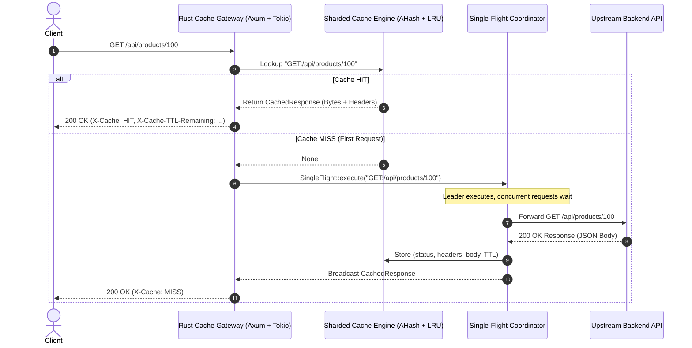

# Rust Cache Gateway — Technical Architecture & Deep Dive

## 1. Overview & System Mission

The **Rust Cache Gateway** is a standalone, production-grade HTTP reverse proxy with an integrated, high-performance in-memory cache engine. It is designed to sit transparently between client applications (web browsers, mobile apps, frontend services) and existing backend APIs (written in Node.js, Python, Laravel, Go, Java, Rust, etc.).

### Primary Goals
1. **Zero Backend Modifications**: Backends do not need any special SDKs; they speak normal HTTP.
2. **Sub-Millisecond Cache Latency**: High-throughput in-memory caching via fine-grained lock sharding and fast hashing.
3. **Cache Stampede Prevention**: Single-Flight request coalescing eliminates backend overload during cache misses.
4. **Data Isolation & Safety**: Authenticated traffic bypasses public caching by default to avoid cross-user data leakage.
5. **Deterministic Memory Limits**: Enforces strict memory caps via LRU (Least Recently Used) eviction.

---

## 2. High-Level Architecture & Data Flow



---

## 3. Core Subsystems & Components

### 3.1. Sharded Cache Storage Engine (`src/cache/`)
Instead of wrapping a single `HashMap` with a global `Arc<RwLock<...>>` (which creates severe lock contention under high concurrency), the gateway uses a **Sharded Architecture**:

- **Hashing**: Uses `ahash::RandomState` for hashing speed.
- **Shard Indexing**: `shard_idx = hash(cache_key) % shard_count` (default: 16 shards).
- **Isolation**: Each shard has its own independent `RwLock`, allowing simultaneous reads and writes to different keys without blocking each other.
- **No Lock Across Awaits**: Locks are acquired only for microseconds to read or insert entries, and dropped immediately before making network requests.

```text
Cache Engine (16 Shards)
 ├── Shard 0  [RwLock<HashMap + LRU>] -> Atomic Counters (hits, misses, bytes)
 ├── Shard 1  [RwLock<HashMap + LRU>] -> Atomic Counters
 ├── ...
 └── Shard 15 [RwLock<HashMap + LRU>] -> Atomic Counters
```

---

### 3.2. Cache Key Normalization (`src/cache/key.rs`)
Query parameters often arrive in arbitrary order (e.g., from different web frameworks). The gateway normalizes parameters alphabetically so they resolve to the exact same cache entry:

- `GET /products?limit=20&page=1`
- `GET /products?page=1&limit=20`

Both generate: `GET:/products:?limit=20&page=1`.

---

### 3.3. Cache Stampede Protection (Single-Flight) (`src/cache/singleflight.rs`)
When a popular item's cache expires and 1,000 requests hit the gateway simultaneously (the "thundering herd" or "dogpiling" problem):

1. The first request becomes the **Leader** and initiates the HTTP request to the backend.
2. The remaining 999 requests detect an in-flight operation and subscribe to a Tokio `broadcast` channel.
3. When the leader finishes, the result is cached and broadcast to all 999 awaiting requests.
4. **Result**: Exactly **1** request hits the backend database, protecting upstream services from overload.

---

### 3.4. Memory Accounting & LRU Eviction (`src/cache/eviction.rs`, `src/cache/shard.rs`)
To prevent out-of-memory crashes:
- Each cached response tracks its approximate memory consumption: `body.len() + headers_len + std::mem::size_of::<CachedResponse>()`.
- Each shard enforces a max memory cap: `max_memory_mb / shard_count`.
- When an insertion causes memory to exceed the cap, `LruTracker` pops the least-recently-used keys until memory falls below the threshold.

---

### 3.5. Route-Based TTL Rules (`src/cache/ttl.rs`)
TTL can be configured per route using pattern matching:

```toml
[cache]
default_ttl_seconds = 60

[[cache.rules]]
pattern = "/api/products/*"   # All product routes cached for 5 mins
ttl_seconds = 300

[[cache.rules]]
pattern = "/api/users/*"      # User routes cached for 1 min
ttl_seconds = 60

[[cache.rules]]
pattern = "/api/config"       # Static config cached for 1 hour
ttl_seconds = 3600
```

---

### 3.6. HTTP Method Policy & Safe Invalidation (`src/middleware/`)

| Method | Default Policy | Cache Behavior |
|---|---|---|
| `GET` / `HEAD` | **Cacheable** | Served from cache on HIT; stored with TTL on MISS. |
| `POST` | **Bypass** | Forwarded directly to backend; not cached. |
| `PUT` / `PATCH` | **Invalidate** | Forwarded to backend; on `2xx` response, invalidates matching path entries. |
| `DELETE` | **Invalidate** | Forwarded to backend; on `2xx` response, invalidates matching path entries. |
| `OPTIONS` | **Bypass** | Forwarded directly to backend. |

#### Invalidation Flow Example:
1. `GET /api/products/100` -> **Cached**.
2. `PUT /api/products/100` -> Forwarded to backend. Backend returns `200 OK`.
3. Gateway automatically purges `GET:/api/products/100` (including any query variants) from cache.
4. Next `GET /api/products/100` -> **Cache MISS**, fetching fresh data from backend.

---

### 3.7. Security & Authentication Isolation (`src/proxy/request.rs`)
- **Private Data Protection**: Any incoming request containing `Authorization` or `Proxy-Authorization` headers automatically **bypasses public caching**.
- **Hop-by-Hop Stripping**: Strips proxy-specific headers (`Connection`, `Keep-Alive`, `Upgrade`, `Transfer-Encoding`) to comply with RFC 7230.
- **Traceability**: Injects or preserves `X-Request-ID` across all logs, metrics, and responses.

---

## 4. Observability & Administration Endpoints

### 4.1. Health Check
```http
GET /health
```
```json
{
  "status": "ok",
  "cache_enabled": true,
  "cache_entries": 142,
  "memory_used_bytes": 1048576,
  "hit_rate_pct": "94.20%"
}
```

### 4.2. Admin Statistics
```http
GET /admin/stats
```
```json
{
  "keys": 142,
  "hits": 45120,
  "misses": 2770,
  "sets": 2770,
  "deletes": 15,
  "evictions": 0,
  "expired": 340,
  "memory_bytes": 1048576,
  "hit_rate_pct": "94.22%",
  "shard_count": 16
}
```

### 4.3. Prometheus Metrics
```http
GET /metrics
```
Exposes standard Prometheus metrics including `cache_hits_total`, `cache_misses_total`, `backend_requests_total`, `backend_duration_seconds_bucket`, and `http_request_duration_seconds_bucket`.

### 4.4. Cache Purge
- **Purge All**: `DELETE /admin/cache`
- **Purge Key**: `DELETE /admin/cache/:key`

---

## 5. Verification & Testing Summary

The gateway includes an automated test suite verifying every component:

```bash
cargo test
```

- **`cache_tests.rs`**: Verifies SET, GET, DELETE, expiration, memory caps, and LRU eviction order.
- **`ttl_tests.rs`**: Validates wildcard path matching and hierarchical TTL rules.
- **`invalidation_tests.rs`**: Tests prefix invalidation upon mutation.
- **`proxy_tests.rs`**: Tests query parameter normalization, hop-by-hop header removal, and auth bypass.
- **`integration_tests.rs`**: Starts a mock backend and tests the full end-to-end flow:
  1. Cold request -> `x-cache: MISS`.
  2. Warm request -> `x-cache: HIT` (backend not touched).
  3. `PUT` mutation -> Cache invalidated.
  4. Concurrent stampede -> 10 parallel requests coalesced into 1 backend fetch.
